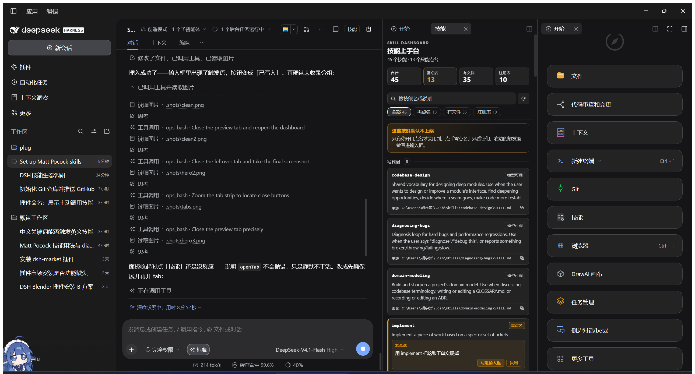

# dsh-skill-dashboard

A [DeepSeek Harness](https://github.com/deepseek-ai) plugin: one page that shows every skill you have installed, which of them can only be called by name, and the sentence that calls each one.



## What it solves

Install enough skill packs and two things break:

1. **You stop knowing what you have.** Skills land in `~/.dsh/skills`, in project `.dsh/skills`, inside packages, and in plugin registries that never touch disk.
2. **The best ones are invisible.** A skill with `disable-model-invocation: true` stays out of the model's catalog on purpose — the model cannot even try to use it, and the tool call fails with `not available for model invocation`. Only a user who knows the exact name can call it.

The dashboard is the missing index for both.

## Features

- **Every skill in one list**, grouped by *situation* — what you are trying to do (write code / review / write docs / research / design / learn / maintain the harness) — not by which repository it came from.
- **Manual-only skills called out** with a badge and a trigger phrase you can insert into the composer in one click; the phrase is appended, never sent, and never overwrites a draft.
- **Search and filters**: name or description, name-only, on-disk, registry-only.
- **Origin** per card: the repository URL when the taxonomy knows it, the file path otherwise, one click to copy.
- **Live catalog**: it reads the host's `sessionSkillCatalog`, so user, project, bundled and runtime-registered skills all appear, and a skill installed later shows up on the next refresh (30s).

## Install

Requires DSH with the right Sidebar (`@deepseek-ai/dsh-client-ui-sidebar-right`), which ships with the default web profile.

```js
// from a local checkout
plugin_manager({ action: 'install_bundle', target: 'D:/path/to/dsh-skill-dashboard' })
```

```js
// after the package is published
plugin_manager({ action: 'install_bundle', target: 'dsh-skill-dashboard' })
```

Open it from the **Skills** button in the session header, or from the right sidebar's `+` → guide.

## Taxonomy

Grouping and trigger phrases live in [`taxonomy.json`](taxonomy.json) — plain data, no rebuild:

```json
{
  "situations": [{ "id": "code", "title": "写代码", "order": 10 }],
  "skills": {
    "tdd": { "situation": "code" },
    "handoff": { "situation": "docs", "trigger": "用 handoff 把这次对话整理成交接文档" }
  }
}
```

- A skill that is not listed still appears, sorted by an inference over its name and description (marked `auto`), or under **其他 / Other** when nothing matches.
- `trigger` is optional; when absent the sentence is generated from the skill's own description.
- `zh` is optional: the Chinese description shown instead of the English one.
- `repo` is optional; it turns the origin line into a copyable repository URL.
- `node tools/check-taxonomy.mjs` validates the file (CI runs it too).

### Your own override

Put a file at `~/.dsh/skill-dashboard/taxonomy.json` with the same shape. It is layered over the packaged table per skill, so you can move your own skills without touching the package:

```json
{ "skills": { "my-deploy-helper": { "situation": "harness" } } }
```

Overrides can add situations and change skills — they never delete a packaged entry. A malformed file is ignored, and the dashboard shows a line saying so instead of going blank.

## Non-goals

This plugin is **read-only by design** — see [ADR 0001](docs/adr/0001-read-only-by-design.md). It does not install, uninstall, update, enable or disable skills; `@michengai/dsh-skills-manager` and `@linxin666/dsh-client-ui-skill-explorer` already own that, and a second installer would only drift.

It also does not browse skills you have *not* installed.

## Development

```bash
node --check index.js
node --check client.js
node tools/check-taxonomy.mjs
```

Host half: `index.js` serves `GET /api/skill-dash/data` (catalog + taxonomy merged). Client half: `client.js` registers the tab, its body, and the header button. After editing `index.js`, reload the bundle (`plugin_manager set_bundle` off, then on) — HMR does not re-import the Host module. After editing `client.js`, reload the page.

## License

MIT.

---

# 中文

一个 DSH 插件：一页看全已装技能，标出哪些只能点名调用，并给出一句可以直接写进输入框的触发语。

## 它解决什么

技能装多了会坏两件事：

1. **不知道自己有哪些** —— 技能散在 `~/.dsh/skills`、项目 `.dsh/skills`、插件包、以及根本不落盘的注册表里。
2. **最好的那批是隐形的** —— 声明了 `disable-model-invocation: true` 的技能故意不进模型的技能目录，模型连试都试不了，调用会直接报 `not available for model invocation`。只有知道确切名字的用户才叫得动。

上手台就是这两件事的索引。

## 功能

- **一张清单看全**，按**处境**分组（写代码 / 审代码 / 写文档 / 研究查证 / 设计出图 / 学习 / 维护 harness），而不是按仓库来源。
- **手动型技能单列**：金色边 + 徽章 + 触发语，一键写进输入框（追加，不发送，不覆盖已有草稿）。
- **搜索与筛选**：名字/说明、只看需点名、只看有文件、只看注册表。
- **来源**：taxonomy 里有仓库地址就显示地址，否则显示文件路径，一键复制。
- 数据来自宿主的 `sessionSkillCatalog`，用户/项目/随包/注册表型技能都在；新装的 30 秒内自动出现。

## 安装

需要带右侧栏的 DSH（默认 Web profile 自带 `@deepseek-ai/dsh-client-ui-sidebar-right`）。

```js
plugin_manager({ action: 'install_bundle', target: 'D:/path/to/dsh-skill-dashboard' })
```

入口：会话标题栏的「技能」按钮，或右侧栏 `+` → 开始 里的「技能」。

## 归类表

分组和触发语都在 [`taxonomy.json`](taxonomy.json)，改它不用重新构建：

- 没收录的技能照常显示，归到「其他」。
- `trigger` 可省，省了就用技能自己的 description 自动生成。
- `repo` 可省，填了来源行就变成可复制的仓库地址。
- `node tools/check-taxonomy.mjs` 校验，CI 也会跑。

### 你自己的覆盖表

把同结构的文件放到 `~/.dsh/skill-dashboard/taxonomy.json`，它会按技能名叠加在包内表上——你机器上的技能可以自己归位，不用改包里的文件：

```json
{ "skills": { "my-deploy-helper": { "situation": "harness" } } }
```

覆盖表能加处境、改技能，但**删不掉**包内已有条目。文件写坏时会被忽略，界面上会多一行说明，而不是直接空白。

## 非目标

**只读**（见 [ADR 0001](docs/adr/0001-read-only-by-design.md)）：不装、不卸、不更新、不启停。这些事 `@michengai/dsh-skills-manager` 和 `@linxin666/dsh-client-ui-skill-explorer` 已经在做，再做一遍只会各自漂移。

也不做「未安装技能」的浏览。

## 开发

```bash
node --check index.js
node --check client.js
node tools/check-taxonomy.mjs
```

改 `index.js` 后要重载 bundle（`plugin_manager set_bundle` 关再开）—— HMR 不会重新 import Host 模块；改 `client.js` 刷新页面即可。

## 许可证

MIT。
